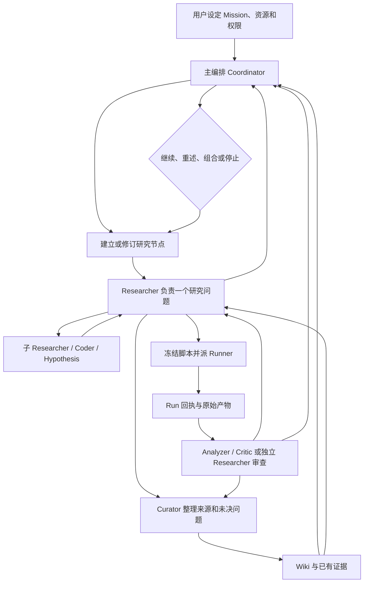

# RSI 研究系统

RSI 用于持续、多路线的研究任务：把问题、研究节点的版本、Agent 之间的交接、实验输入和结果保留下来，让下一轮能接着做，也让结论可以回到具体证据。它不是机器人算法，也不保证多 Agent 一定比单 Agent 研究得更好。

## 与 Codex Goal 的区别

Codex Goal 适合让一个 Codex 任务持续推进到完成；它也能组织子任务、使用 Git 和运行实验。RSI 增加的是跨任务的**研究状态和实验账本**：同一个 Mission 下，多个研究方向可以独立推进，节点有历史版本，结果关联到具体任务、源码和 Run，失败、反对意见和未决问题不会在下一次对话中消失。

是否值得使用 RSI，要看这些记录能否让后续研究少做无效实验、得到更可信的改进。如果一次性任务用 Goal、Git 和实验记录就足够，不必额外运行 RSI。

## 系统怎样工作



1. 用户用 Mission 给出研究目标、已知材料、预算、可用实验环境和停止条件。主编排阅读这些材料，建立可修订的研究蓝图，把**研究责任**交给 Researcher；它可以提出方法建议，但不替每个分支预选算法。
2. Researcher 读 Wiki、文献和源码，自主形成解释、原型及局部验证计划；复杂问题可继续派子 Researcher。形成可执行方案后，由 Coder 或 Researcher 在自己的工作区发布脚本。研究节点和任务分开保存：任务结束不等于问题已经解决。
3. 正式仿真通过 Runner 执行冻结脚本。Runner 是执行程序，不是决定科研方向的聊天 Agent。它保存输入、版本、日志、产物和回执；本地 bash/Python 检查只是诊断，不能冒充正式 Run。
4. Researcher 收到结果后继续解释、修订或换方向；需要时显式派 Analyzer、Critic 或独立 Researcher 审查。主编排可以在重要取舍处派一个 `problem_reframe` Researcher 重新理解总问题，也可以让分支继续独立发展。组合节点保留来源版本，不等于合并代码或证明组合有效。
5. Curator 把有来源的发现、负结果和未决事项整理进 Wiki。Wiki 是下一次研究的输入；写入页面本身不等于系统已经从经验中学会了什么。

主编排不必等所有并行分支结束才查看先到的结果；它可以提前审查并决定等待。并发上限限制同时执行的任务数，不构成“这一批任务全部完成”的屏障。消息写入、脚本完成、Run 成功、指标改善和科研结论也分别是不同的状态。

## 有哪些 Agent

| 角色 | 主要责任 |
| --- | --- |
| Coordinator | 管全局蓝图、分支之间的取舍、资源分配与停止复核。 |
| Researcher | 管自己负责的问题：读资料、形成机制、派子任务、解释结果并继续迭代。独立问题重述仍是 Researcher 任务。 |
| Hypothesis | 把成熟的想法整理为可证伪的假设；不是每条 Idea 都必须晋升。 |
| Coder | 在独立工作区实现、调试并发布带自检的代码或探针。 |
| Runner | 确定性地执行冻结输入，生成 Run 回执，不解释科学结论。 |
| Analyzer | 在自己的工作区重算指标、检查对照与成本。 |
| Critic | 独立查反例、证据来源和归因，提出能区分解释的检查。 |
| Curator | 按来源整理 Wiki，保留负结果、分歧和重开条件。 |

所有模型 Agent 都能在自己的工作区写作。Researcher、Coder 及审计角色可在各自的受控范围内使用 bash/Python；对原始证据、别人的交接、运行时数据库和凭证的读写边界由运行时控制。模型与思维强度由私有配置选择，不写死在角色代码里。

## 这次 Mission 的提示词例子

下面是截至 2026-09-30 09:50（北京时间）`body-memory-open-20260929-001` 的**实际任务目标节选**，保留了任务 ID，便于在运行数据库中查完整记录。它们不是完整的模型输入：运行时还会拼入 [角色职责](rsi_system/core/runtime_roles.py)、Mission 状态、任务作用域、Wiki/证据地址、工具权限和输出格式。引文仅展示本次派单如何从总问题逐步落实到验证，不代表结果已经成立。

| 角色与任务 | 实际目标节选 |
| --- | --- |
| Coordinator `task-df800680b80b95c68cd9` | “在冻结 pi0.5 LIBERO 基座的前提下，研究身体 Memory 是否能通过少量交互形成可复用的身体响应认识……主编排先建立研究蓝图和竞争解释，再按研究责任派发 Researcher。” |
| 方向 Researcher `task-61510a5c6283a559fe3b` | “Own the representation, acquisition/lifecycle, receiving interface and smallest decision-changing causal transfer test; compare credible simpler no-memory feedback/fresh calibration explanations, not only passive RMSE.” |
| 子 Researcher `task-f3eb7d9a8aa5fc77531a` | “Create a bounded Runner-ready policy-enabled LIBERO transfer probe in your own workspace… comparing reset/no-memory public-feedback, retained low-dimensional response state, and stale/shuffled state where the interface permits.” |
| Runner `task-4236bb197efb79c3aa73` | “Execute the newly published policy-enabled support/query probe in the authorized pi05-libero Runner environment. Inspect the typed receipt and structured payload separately.” |
| 独立审查 Researcher `task-749be03e7ed955851409` | “Independently audit completed policy Run run-54b5a357513984ac62877b5c… Reaggregate source/query actions and failures, distinguish equal-overhead accounting from feedback query-only and retained acquisition cost.” |
| 独立问题重述 Researcher `task-8e200aeceb044d00e27e` | “Independently restate the whole Mission after first policy Run… Retained early response fit improves, but acquisition costs overturn the target-only advantage; fresh and retained nearly tie. Do not presume durable scalar memory or a fixed replication grid.” |
| Curator `task-845270304c1ed7e4d57a` | “Curate new published research records into source-linked draft Wiki pages.” |

这次已完成的策略 Run `run-54b5a357513984ac62877b5c` 在一个配对测试中执行了真实 pi0.5/LIBERO 策略；独立审查发现保留状态与新鲜校准只差一个目标任务步数，计入获取经验的成本后还不能证明 Memory 收益。主编排因此派出上面的独立问题重述任务。**这是一段真实研究流程和有限观察，不是新机制已验证的展示。**截至上述快照，这轮没有单独的 Hypothesis、Coder、Analyzer 或 Critic 任务；审计由独立 Researcher 完成，所以表中没有伪造这些角色的本轮提示词。

## 使用

安装后，在项目根目录运行：

```bash
python -m pip install -e ".[test]"
python -m rsi_system.core.runtime_cli --root . start deployment/rsi/mission.example.json
python -m rsi_system.core.runtime_cli --root . status
python -m rsi_system.core.runtime_cli --root . tick
python -m rsi_system.dashboard.server --root . --port 8765
```

看板只监听 `http://127.0.0.1:8765/`。`start` 只登记 Mission；`tick` 可能创建或执行任务，也可能返回等待，并不保证每次都调用模型。后台定时服务是可选的；RSI 核心使用 Python、SQLite 和本地文件，不依赖 Linux。bubblewrap 和 systemd 是 Linux 上可选的隔离与后台运行组件；正式 Runner 可使用由管理员配置的 Docker 环境。没有受控执行环境时，不应把普通 shell 诊断称作正式实验。

看板的“场景 → 研究节点”读取真实研究图。选择任意现有节点，点“新增研究方向”可提交人工提议；它会作为 `proposed` 子节点保留父节点版本，并通知主编排评估。提交不自动派 Researcher 或启动实验。

模型供应商和角色路由从私有配置读取。仓库中的 [`config/`](config/) 提供不含密钥的示例；运行状态、凭证、模型权重和实验数据库不应提交到 Git。更多 Mission 字段、暂停/恢复、工具和 Runner 回执操作见 [用户指南](USER_GUIDE_CN.md)，Runner 环境见 [环境指南](docs/design/runner-environments.md)。
