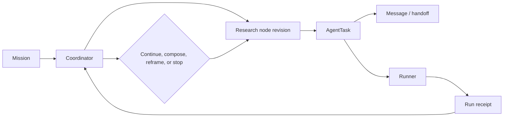

# Standalone RSI System

This directory is a self-contained copy of the RSI control plane and local
dashboard. It contains source code, tests, static dashboard assets, and
deployment examples. Runtime state, credentials, model checkpoints, caches,
and databases are intentionally excluded.

## Quick start

From this standalone project directory (after `pip install -e .`):

```bash
python -m rsi_system.core.runtime_cli --root . start deployment/rsi/mission.example.json
python -m rsi_system.dashboard.server --root . --port 8765
```

The dashboard is local-only at `http://127.0.0.1:8765/`. Set `RSI_CONFIG_DIR`
to a private directory containing a copy of `config/private.example.json` when
you want to configure a provider. API keys belong in the private directory or
the Pi credential store and must never be committed here.

For an OpenAI-compatible provider, start from
`config/providers.example.json`; it shows the public endpoint and a private
key-file reference without containing a key.

Model selection has no built-in provider or model. Add an explicit role entry
or `model_routing` map in private configuration before enabling model calls.

The core runtime is cross-platform: it uses Python, SQLite, local files, and
the configured Pi-compatible model client. Linux is not a prerequisite for
Mission orchestration or the dashboard. Linux-only pieces are optional
hardening and operations helpers: bubblewrap isolates researcher/coder shell
and review commands, while systemd and Secret Service provide background
timers and credential storage. On macOS or Windows, run the core and dashboard
directly; do not treat an unisolated shell as a formal, trusted experiment.

## Layout

- `rsi_system/core/`: control plane, runtime, evidence, protocol contracts, and tests.
- `rsi_system/dashboard/`: Python server, static UI, React source, and dashboard tests.
- `deployment/rsi/`: portable configuration plus optional Linux service examples.
- `config/`: public and private configuration templates.

The [user guide](USER_GUIDE_CN.md) explains the runtime contracts and limits.
The agreed [hierarchical research responsibilities](docs/design/hierarchical-research-responsibilities-20260929.md) record the next prompt and workflow design; they are not a claim of completed implementation.
The overview image is an interface illustration only:


`examples/missions/first-mission.json` and
`examples/results/sample-result.json` are engineering/exploration fixtures.
They contain no model output or scientific conclusion.

## What RSI adds

Codex Goal mode tracks what the current Codex conversation should finish. RSI
Mission is a durable runtime object with a SQLite event log, versioned research
nodes, recursive AgentTask records, directed messages, handoff snapshots, and
bounded Runner receipts. Goal mode can ask Codex to inspect or change RSI; it
does not replace the Mission ledger or its recovery rules.

The runtime uses these responsibilities:

| Role | Responsibility |
| --- | --- |
| `coordinator` | Own the Mission blueprint, resource decisions, synthesis, and stop review. |
| `researcher` | Explore a research node, read sources, propose mechanisms, and interpret results. |
| `hypothesis` | Turn an Idea into a falsifiable statement, mechanism, assumptions, predictions, and design. |
| `coder` | Build a scoped implementation and publish reproducible checks. |
| `runner` | Execute frozen scripts or Candidates and write a typed Run receipt. |
| `analyzer` | Compare a receipt with predictions, controls, samples, and metrics. |
| `critic` | Check alternatives, provenance, causal claims, and material code allegations. |
| `curator` | Preserve source-linked findings, negative results, and open questions in the Wiki. |

The design keeps three things separate: the coordinator chooses research
responsibilities and resource tradeoffs; researchers choose concrete mechanisms
and checks inside their nodes; the runtime enforces versions, permissions,
budgets, hashes, and recovery. A prompt can suggest a route, but it cannot
silently turn that suggestion into a fixed experiment.

The main collaboration path is:



`rsi_message` stores an attributed message; it does not prove that the
recipient has read it. A finished task publishes a hash-checked UTF-8 handoff
manifest, which a parent reads with `rsi_read_handoff`. A Run receipt records
the frozen source, inputs, outputs, hashes, logs, and execution status. A
successful receipt proves an execution was saved; it is not by itself a
scientific conclusion.

Research nodes can be split with `rsi_research(action="create")`, revised
without deleting older revisions, or composed from at least two exact historical
`node_id + revision` references. Composition preserves source branches and is
not a code merge or evidence of compatibility. Historical snapshots and
append-only `rollback`/`revoke` lifecycle records provide a way to revisit a
decision without rewriting its tasks or receipts.

When a branch is converging around its first explanation, the coordinator can
dispatch one independent `problem_reframe` researcher on the Mission root.
That task has no Idea or Candidate anchor and must return a competing problem
statement and a check that could change the plan. The coordinator records
whether the challenge is adopted, deferred, or rejected with evidence; the
reframe is not an automatic finding.

For the full Mission schema, minimal example, configuration rules, command
walkthrough, tests, and the explicit boundary between an engineering result
and a research claim, read [USER_GUIDE_CN.md](USER_GUIDE_CN.md).

The protocol registry can be extended with optional experiment adapters. Their
simulators, datasets, and checkpoints are not included here; provide those
components explicitly before queueing a formal experiment.
