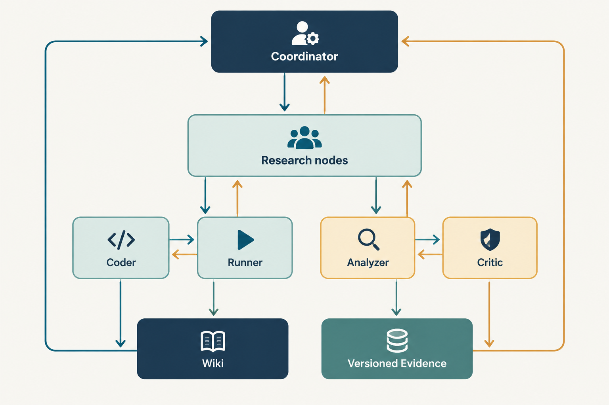

# RSI 用户指南

这份指南面向第一次运行 RSI 的用户。以下命令都从独立项目根目录执行。RSI 核心使用 Python、SQLite 和本地文件，可在 macOS、Linux、Windows 上运行；Linux 只用于可选的 bubblewrap 隔离和 systemd 后台服务。RSI 是一个可恢复的研究运行时：先登记 Mission，再由 coordinator 和协作者在运行时登记节点、任务、消息、交接和受控 Run。文档中的“结果”指工程记录或探索性观察；除非有明确评测合同和独立核查，否则不要写成科研结论。
界面概览（仅用于说明布局，不是科研结果）：



首次使用先安装本地包；这只安装 RSI 的 Python 依赖，不写入模型凭证：

```bash
python -m pip install -e ".[test]"
```

## Goal 模式和 RSI Mission 的区别

Codex Goal/目标模式服务于当前 Codex 对话，帮助保持一个完成目标和检查进度。RSI Mission 是独立的持久运行时对象：它在 SQLite 中保存研究节点版本、递归任务、消息、handoff 和 Run receipt，可以在进程重启后恢复。Goal 可以要求 Codex 检查或修改 RSI；Goal 本身不会替代 Mission 的账本、权限和回执规则。

## 1. 先理解 Mission

Mission 是一份用户拥有的输入和边界，至少包含：

- `mission_id`：稳定、简短的标识；
- `objective`：要回答或改善的问题；
- `background`、`known_evidence`：背景和已知资料；
- `resources`：任务数量、Run 数、并发和单次 Run 时间；
- `stop_conditions`：停止时需要交付的内容或资源条件；
- `authorization`：是否允许代码 Candidate 或服务器模拟；
- `mode`：`open`、`delivery` 或 `confirmation`。

最小资料可以这样写：

```json
{
  "mission_id": "sharing-methods-001",
  "objective": "比较三种团队知识分享方式，说明适用条件和仍需验证的问题。",
  "background": "只使用公开资料，先形成可核查的比较。",
  "known_evidence": [],
  "resources": {
    "max_agent_tasks": 8,
    "max_runs": 1,
    "max_seconds_per_run": 120,
    "max_parallel_agents": 2,
    "max_parallel_runs": 1
  },
  "stop_conditions": ["形成带来源的比较、限制和下一步检查"],
  "authorization": {
    "allow_code_candidates": false,
    "allow_server_simulation": false
  },
  "mode": "open"
}
```

不要把 API key、私有地址或账号放进 Mission。`known_evidence` 只声明资料位置；runtime 会记录实际读取和哈希，读取失败必须保留为失败状态。

## 2. 启动、查看和控制

```bash
python -m rsi_system.core.runtime_cli --root . start /tmp/rsi-mission.json
python -m rsi_system.core.runtime_cli --root . status
python -m rsi_system.core.runtime_cli --root . tick
```

输出是 JSON。`start` 会创建 Mission 根研究节点；`tick` 可能创建 coordinator、领取已排队任务、写回结果或返回 `waiting`。它不保证每次都会调用模型。

只推进已登记的协作者，不新建 coordinator：

```bash
python -m rsi_system.core.runtime_cli --root . work
python -m rsi_system.core.runtime_cli --root . work --follow
```

暂停会阻止新的领取和旧状态接纳；已启动的进程会按安全停止规则结束。恢复前先看失败任务和缺失 receipt：

```bash
python -m rsi_system.core.runtime_cli --root . pause sharing-methods-001 --reason "检查失败任务"
python -m rsi_system.core.runtime_cli --root . resume sharing-methods-001 --reason "已完成检查"
```

临时模型错误默认最多追加 2 次关联重试，分别等待 30、60 秒；每次调用仍计入原 Mission 和每日预算。配置文件中的 `runtime_recovery_max_attempts`、`runtime_recovery_retry_seconds`、`runtime_recovery_max_retry_seconds` 控制次数、等待步长和最长等待。工作进程会续期正在执行的任务租约；失败记录不会因为 `resume` 被改成取消。

Runner 会先登记 Run，再执行。恢复时，未启动的任务可继续；已有完整回执的只导入结果；进程仍活着的继续等待；已经跨过启动边界但没有回执的记录为“不确定中断”，交回研究员判断，不自动重跑。`prepared` 记录不算实验成功，也不进入评审证据包。确定需要重测时应创建新任务，说明重测原因并消耗新的实验额度。

研究员不需要后续任务时，省略 `continuation` 或设置 `{"requested": false}`。需要继续时填写真实目标及 `after_task_ids`；系统等来源任务完成和这些依赖结束后才领取，失败结果也会交给研究员分析。不要把“不需要后续任务”写进 `objective`，那仍表示请求一项任务。

`status` 读取 `.rsi/runtime/state.sqlite3`。不要直接编辑 SQLite；需要改变状态时使用 CLI 或 Agent 工具，以便事件和版本保持一致。

## 3. 节点、任务和角色如何配合

**研究节点**代表长期问题。它有不可变 revision，记录问题、范围、摘要、owner、执行状态、finding 状态、artifact 和 Run 引用。节点版本用于回答“这个任务当时研究的到底是哪一个问题”。

**AgentTask**代表一次有父任务、作用域、租约和终态的工作。任务可以递归派发；失败和取消也消耗 Mission 任务预算。模型会话中断时，runtime 依据工具调用记录和已发布交接恢复，不能凭空补写“已完成”。

角色职责如下：

| 角色 | 何时使用 | 必须留下的东西 |
| --- | --- | --- |
| coordinator | 设定蓝图、跨分支取舍、复盘和停止 | 任务选择理由、停止复核、未决问题和下一测试 |
| researcher | 探索一个节点，读资料、提机制、解释观察 | `handoff.md`、来源记录、必要的 checkpoint |
| hypothesis | 将 Idea 变成可证伪假设 | 完整假设 revision 和竞争解释 |
| coder | 实现 Idea 或已准入 Candidate | `implementation_note.md`、自检命令和限制 |
| runner | 执行已冻结的探针或 Candidate Run | typed Run receipt、日志和输出哈希 |
| analyzer | 比较 Run 与预测、控制和指标 | 带 Run/file 引用的分析草稿 |
| critic | 独立查缺、反例、归因和复现 | 具体反驳及可区分的下一项检查 |
| curator | 整理 Wiki 草稿和来源 | 符合 schema 的页面提案和链接 |

Idea 可以长期保持草稿；Hypothesis 只有在字段完整且 `candidate_ready` 时才能关联 Candidate。Candidate、代码和 Run 是工程对象，不代表自动产生论文结论。

## 4. 消息、handoff 和等待

Agent 使用 Pi 工具完成协作：

- `rsi_message`：给指定任务或角色发送带作者和 Idea 的消息。消息写入成功只证明保存成功，接收者是否看到要看其工具调用记录。
- `rsi_inbox`：读取输入冻结之后的新消息，也显示同一分支的活跃任务。收到消息后要检查其来源和是否有对应文件或 Run。
- `rsi_delegate`：创建子任务，返回 `task_id`。运行时会检查角色、Idea、研究节点 revision、Candidate、授权和预算。
- `rsi_wait`：等待子任务结果或新消息；返回时仍应调用 `rsi_status` 检查持久状态。
- `rsi_status`：查看子任务终态、摘要、Run、checkpoint 和可用 handoff 文件。
- `rsi_read_handoff`：只读取已完成、失败或取消任务发布的 UTF-8 文件，可用 `file_id`、`offset`、`limit` 分页。

协作者只能写自己的 `.rsi/runtime/tasks/<task-id>/workspace/`。任务完成时，runtime 将工作区文件复制为 `communications/outbox/manifest.json` 指向的快照，记录 SHA-256。未发布的本地路径不能作为父任务证据；失败任务的笔记会保留，但状态仍是失败。

推荐的最小交接内容：

```markdown
# Handoff
- 已检查的来源和文件：
- 当前观察（不是结论）：
- 仍有争议或未验证的地方：
- 下一项能区分解释的检查：
```

## 5. Run receipt 怎么看

探索探针需要由已完成任务发布的 Python 文件和输入清单启动。Runner 会先预检入口、依赖、路径和输出协议，然后在网络隔离、时间和输出大小受限的环境中执行。每个 Run 使用稳定的 `run_id`，通常在 `.rsi/runtime/runs/<run-id>/run_record.json` 保存 receipt，并记录：

- `source_task_id`、脚本 `file_id` 和源码提交；
- 输入、脚本和产物的 SHA-256；
- `execution_status`、退出码、超时和错误；
- `stdout.log`、`stderr.log` 及其哈希；
- 资源边界和输出文件清单。

相同脚本、输入和源码指纹不会无理由重复；有意重放要填写 `recheck_reason`。Runner 只报告执行和完整性，不判断 Hypothesis/Candidate。导入、语法、入口或输出契约失败属于工程修复，会退回源 coder；不要把它当成科学负结果。

Analyzer 或 Critic 读取 receipt 后，必须区分：

1. 脚本是否执行成功；
2. 输出是否完整、哈希是否匹配；
3. 预先写明的指标和控制观察到什么；
4. 这些观察能否排除其他解释。

“Run completed”只能说明一次受控执行完成。它不能单独证明假设成立、泛化有效或系统获得科研提升。

## 6. 拆分、组合和回溯

### 拆分

Researcher 或 coordinator 调用 `rsi_research(action="create")` 创建子问题。省略 `parent` 时，runtime 使用当前任务绑定的精确节点 revision；coordinator 没有绑定时使用 Mission 根节点。系统写入 `decomposes` 关系并要求后续任务引用具体 revision。需要独立根节点时只能由 coordinator 显式设置 `separate_root=true`。

### 组合

调用 `rsi_research(action="compose")`，在 `data.inputs` 中提供至少两个同一 Mission 的 `{node_id, revision}`，并写 `data.reason` 和组合计划。runtime 会冻结输入节点、已完成的相关任务和 Run 引用，创建新的研究节点、`composed_from` 关系和 researcher 任务。原分支继续保留；组合只是新问题，不是 Git merge，也不是“双方已证明兼容”。

### 回溯

回溯有三种常见动作：

1. 用 `rsi_research(action="snapshot", at_version=...)` 读取历史图，不混入后来事件；
2. 用旧节点 revision 创建或组合新的问题，保留新的理由和出处；
3. 对组合记录 `rollback` 或 `revoke` 生命周期状态。它们追加事件并标记组合状态，不删除节点、任务或 Run receipt。

每次图变更都必须有非空 `data.reason`。历史 revision 和 receipt 不应被改写，否则无法解释当时的决策。

## 7. problem_reframe：主动打破第一条路线

当负结果、反例或目标冲突可能改变研究方向时，coordinator 可以派发：

```json
{
  "role": "researcher",
  "task_kind": "problem_reframe",
  "objective": "重新检查我们真正要解决的问题，并提出两个可能改变当前计划的便宜检查。"
}
```

运行时强制它直接绑定 Mission 根问题，不能带 `idea_id`、`candidate_id` 或回复任务；同一 Mission 只能有一个未完成的独立重构任务。重构 researcher 要质疑目标、预测对象、表示、更新时机和机制，而不是为当前方案补一条理由。完成后 coordinator 记录 `adopt`、`defer` 或 `reject`，引用收到的证据并给出下一项测试。重构本身是研究输入，不是自动结论。

## 8. 配置、模型和安全边界

外部研究代码、结果和模型目录通过私有配置中的 `external_readonly_roots` 提供，例如：

```json
{"external_readonly_roots": [{"name": "research", "path": "/absolute/project/research"}]}
```

默认列表为空。目录名称必须唯一，路径必须为绝对路径且互不包含；只配置该部署已获授权的目录，不包含凭证和运行时数据库。新任务生成只读资源清单，文件工具可读取清单和对应目录，不能写入；模型权重保留在原处，不复制到任务工作区。配置变化不会改写已冻结任务的清单，新配置在后续工作进程执行新任务时生效。清单记录的是访问范围，不代表目录中的数据已经冻结或实验已经成功；正式 Run 仍须保存自己的输入版本和回执。

公共默认配置是 `deployment/rsi/research.json`。私有覆盖文件为 `~/.config/rsi/research.json`；多套配置可通过 `RSI_CONFIG_DIR=/path/to/private` 隔离。常用字段：

```json
{
  "pi_executable": "/absolute/path/to/pi",
  "python": "/absolute/path/to/python",
  "models": {
    "researcher": {"provider": "provider-name", "model": "model-name"}
  },
  "thinking": "high",
  "runtime_max_parallel_agents": 2,
  "runtime_max_parallel_runs": 1,
  "agent_timeout_seconds": 600
}
```

模型供应商的非密钥索引由 Pi 使用；API key 放在私有 key 文件或系统 Secret Service，权限应为 0600。不要把真实 key、私有 URL、token、账号或机器路径提交到仓库。任务授权仍由 Mission 决定：没有 `allow_code_candidates` 时，coder 派发会被拒绝；没有服务器模拟授权时，不应把本地草稿称为服务器实验。

首次安装 Python 包后，在 macOS 或 Windows 也可以启动 Mission、使用节点图、消息、handoff、Wiki 和看板。没有 Linux/bubblewrap 时，核心流程仍然可用，researcher/coder 可以进行普通本地调用，但运行时会把它与隔离 shell 区分开；未经隔离执行的代码不能称为受控 Runner 实验。用户可在 macOS 使用容器运行器或其他隔离执行器，需另行接入和验收。

## 9. 看板和后台服务

本地前台看板：

```bash
python -m rsi_system.dashboard.server --root . --port 8765
```

它监听 `127.0.0.1`，读取真实数据库和事件。通过看板创建 Mission 时，初始状态是 `paused`，用户必须显式点击运行或调用相应 API；这避免误触其他 Mission。Linux 部署目录另提供 systemd unit 和 timer，用于无人值守后台运行；它们不是核心运行依赖。

## 10. 测试和验收

```bash
python -m pytest rsi_system/core/tests rsi_system/dashboard/tests -q
python -m rsi_system.core --root . lint
```

控制面测试包括任务租约和恢复、消息收件、handoff 清单、Run receipt 幂等、研究节点 revision、组合和回溯、problem_reframe 约束、预算、权限、输入冻结和哈希完整性。看板测试包括只读快照、私有配置不泄漏 key、Mission 运行范围和缺少依赖时的可读错误。

核心和看板测试可跨平台运行。少数隔离验收需要 Linux bubblewrap；工具桥接测试需要 Node.js，真实模型任务还需要安装 Pi 并配置供应商。被跳过的测试不能算作通过。测试通过也不能推出“RSI 已经自我进化”或“某个方法有效”，因为那需要真实 Mission、预先固定的评测和独立复核。

## 11. 最小流程示例和正确解读

以“比较三种团队知识分享方式”为例：

1. `start` 登记 Mission 和根节点；
2. coordinator 创建两个或多个研究节点，分别查资料和提出可检验差异；
3. researcher 通过 `rsi_delegate` 派发 coder 或 runner，并用 `rsi_message` 传递反例；
4. 子任务完成后发布 handoff，Runner 写入 Run receipt；
5. coordinator 读取 receipt 和分析，必要时 `compose` 两个历史 revision，或派发 `problem_reframe`；
6. 资源耗尽或停止条件满足时，记录保留的替代解释、未决问题和下一项测试。

这条流程示范的是记录、派发、回执、回溯和停止的工程行为。即便输出了一份看似清楚的比较，也只能称为该 Mission 的探索性结果；它不是科研结论，不代表全局最优，也不代表 RSI 的自主研究质量已经被证明。
